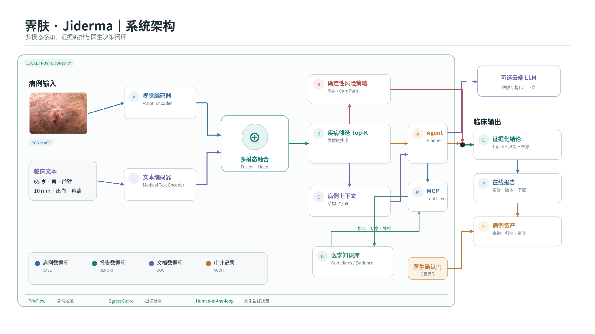
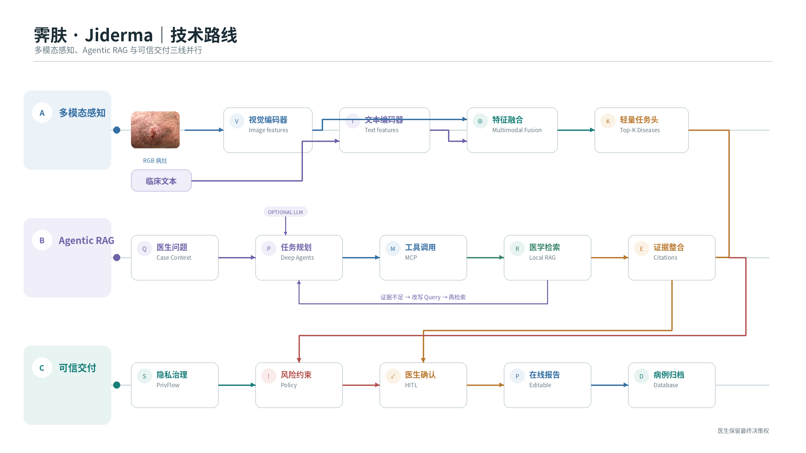
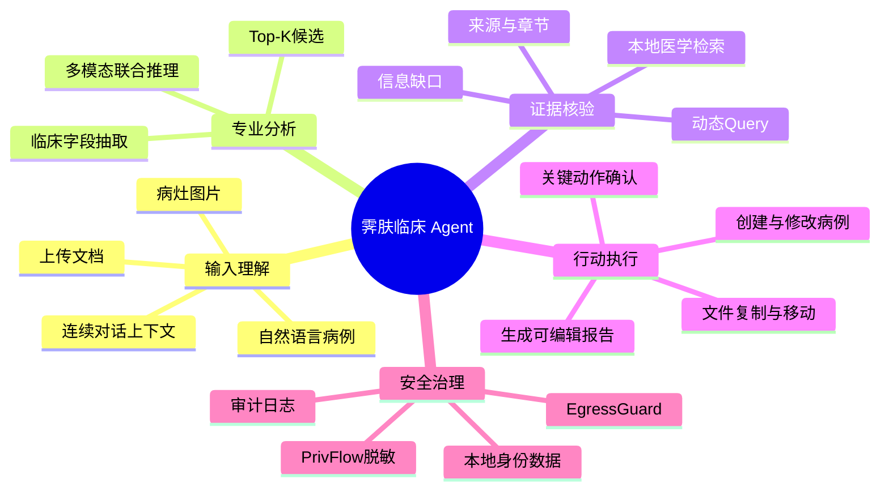
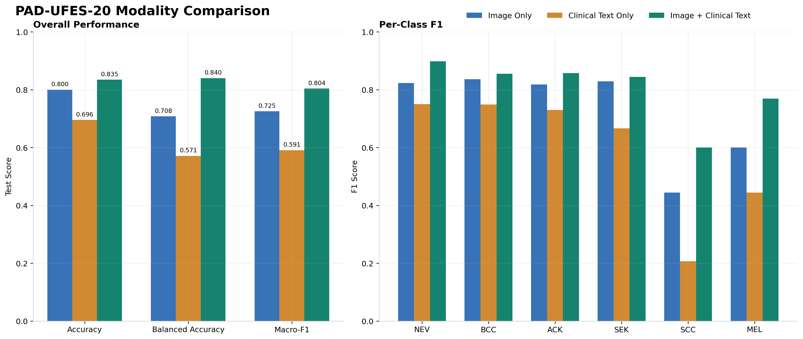
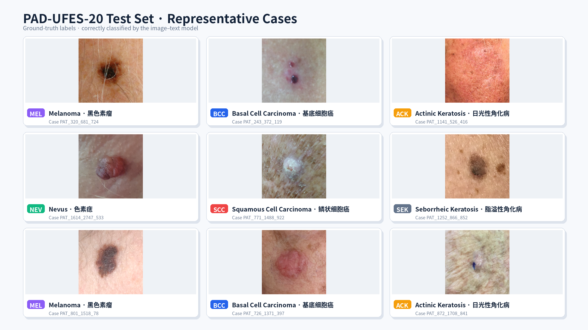
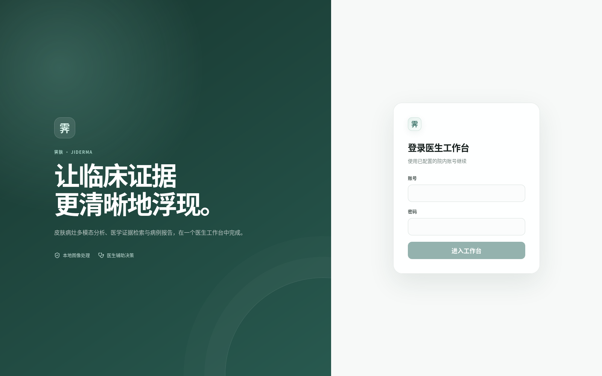

# 霁肤 · Jiderma 项目汇报（详细版）

## 面向基层医生的皮肤病辅助决策 Agent

> 汇报口径：本文以当前项目代码、训练结果和可运行工作流为依据。系统当前采用轻量、可审计的传统RAG作为医学证据基线；Neo4j、Qdrant、CARE、BM25混合召回、RRF和Reranker属于后续规模化增强方案，不作为已经完成的功能陈述。

---

## 第 1 页｜项目概述与 Motivation

基层皮肤病首诊并不是一次单纯的图片分类。医生需要同时处理病灶图像、患者年龄与部位、症状变化、危险征象、鉴别依据、转诊条件以及病例归档。传统工具往往彼此割裂：视觉模型缺少临床上下文，通用大模型依据不可控，知识检索和病例报告又需要人工重复整理。

医疗智能体的关键挑战并不是让LLM“更敢回答”，而是平衡语言模型的理解与生成能力、医学证据的可靠性以及临床操作的可控性。霁肤采用**能力分层**：允许LLM灵活完成意图理解、任务规划、查询构造和自然语言解释，同时限制其在医学事实生成与关键数据操作上的自由度。医学事实优先由本地知识库提供，重要操作由医生确认。

霁肤将这些环节组织为一个由医生控制的临床 Agent 工作台：

```text
病例描述与病灶图像
→ 临床信息结构化
→ 本地多模态分析
→ Agent 识别证据缺口
→ MCP 调用本地知识检索与业务工具
→ 生成带来源的解释和可编辑报告
→ 医生确认后归档
```

项目目标不是替代医生诊断，而是让 AI 以**过程可见、依据可查、操作可控、资料可管理**的方式参与基层临床工作流。

### 当前成果概览

| 维度 | 已完成内容 |
|---|---|
| 多模态分析 | RGB 临床图像与自然语言病例信息联合分类 |
| Agent Harness | Deep Agents + LangGraph 状态图、任务事件和确认门 |
| 工具协议 | 6 个 MCP 工具统一访问视觉、分诊、指南、照护路径、隐私和公开检索 |
| 医学检索 | 17篇本地Markdown资料、查询扩展、Dense检索或词法降级、文档去重与引用元数据 |
| 医生工作台 | 登录、连续对话、病例/报告/文档库、文件夹、搜索、在线编辑与下载 |
| 隐私治理 | 本地病例存储、云端调用前脱敏、EgressGuard 检查与审计 |

<div style="page-break-after: always;"></div>

---

# 三、分析方法选择（2 页）

## 第 2 页｜所选分析方法

项目采用三类互补方法，而不是把所有问题交给单一大模型。

### 1. 多模态对照实验

使用 PAD-UFES-20 官方划分，在相同分类任务下比较：

- `image_only`：只输入 RGB 图像；
- `text_only`：只输入年龄、性别、部位、尺寸、症状与病史；
- `image_text`：联合输入图像与临床文本。

该方法直接回答一个业务问题：**临床文本是否真正改善图像判断，而不是仅作为报告说明？**

### 2. 临床工作流分解

将医生任务拆为“理解病例—调用模型—检索证据—形成报告—归档管理”，并把每一步映射为可观察的 Agent 状态和工具调用，避免聊天模型只输出一段不可执行的文字。

### 3. 可审计的本地证据基线

传统RAG并不等于放弃LLM能力，而是为医疗Agent建立稳定的Grounding基线。LLM负责问题理解、工具选择、检索词构造和语言表达；医学问题通过MCP的 `search_guideline` 工具访问本地知识库。当前检索器使用查询扩展，在医学Embedding可用时执行Dense Retrieval，不可用时切换为本地词法重叠检索；两种方式是二选一降级关系，并不是Dense与BM25并行融合。返回结果带有来源机构、文档、年份、章节和版本字段，并通过关键词规则标记风险、鉴别、检查、转诊、冲突证据或信息缺口。

这种设计将“创造性”与“权威性”分开：LLM可以灵活组织任务和表达，但不能把参数记忆自动视为医学依据。现有综述支持把RAG定位为医疗LLM常用且仍在持续发展的Grounding路线，而不是已经过时的技术：

- 2025年发表于 *PLOS Digital Health* 的医疗RAG系统综述指出，医疗应用同时存在Naive RAG、Advanced RAG和Modular RAG；该综述强调RAG通过外部知识缓解训练数据滞后、幻觉和透明度不足，同时指出标准化评测与伦理治理仍不充分。[Amugongo等，2025](https://pubmed.ncbi.nlm.nih.gov/40498738/)
- 2025年发表于 *JAMIA* 的系统综述与Meta分析从335篇记录中纳入20项对照研究，报告RAG相对基础LLM的合并效应量OR为1.35（95% CI 1.19–1.53），并把“RAG与Agent结合”列为后续临床系统增强方向。[Liu等，2025](https://pubmed.ncbi.nlm.nih.gov/39812777/)
- 2026年发表于 *BMC Health Services Research* 的系统综述纳入44项医疗幻觉治理研究，其中RAG是评估最频繁的策略（18/44）；综述结论不是依赖单一技术，而是将检索、验证、知识图谱与人在回路组合使用。[Basu与Huynh，2026](https://pubmed.ncbi.nlm.nih.gov/42251377/)

因此，霁肤当前使用传统RAG作为**可审计证据基线**是合理的工程起点；未来加入知识图谱、自反思、混合召回和精排，是在同一证据边界上提高召回质量与验证能力，而不是取消来源治理。

### 方法选择对比

| 候选方法 | 优势 | 业务局限 | 是否采用 |
|---|---|---|---|
| 纯视觉分类 | 推理直接 | 不理解病程与危险征象 | 作为专业工具，不单独决策 |
| 通用 LLM 问答 | 交互自然、理解灵活 | 医学依据和操作边界不稳定 | 承担理解、规划、查询构造与表达 |
| 固定规则流程 | 可控 | 难适应复杂连续指令 | 保留在关键安全节点 |
| 多模态 + Agent + 本地检索 | 同时利用图像、文本、工具和可追溯证据 | 当前为轻量证据基线，后续可扩展检索规模与排序能力 | **当前项目主方案** |

<div style="page-break-after: always;"></div>

## 第 3 页｜选择依据与场景适配优势

### 实际系统架构





### 为什么适合基层业务

1. **减少重复录入**：医生在对话框中一次描述病例，系统自动形成结构化字段并复用上下文。
2. **利用图像之外的临床信息**：年龄、部位、病灶变化等信息直接进入多模态模型。
3. **降低知识查找成本**：Agent围绕当前候选和阳性症状动态检索，而不是让医生重新组织检索词。
4. **维持医生控制权**：读取、检索和草拟可以自主完成；病例写入、修改、正式报告生成和删除进入确认门。
5. **适应弱网络与成本约束**：多模态模型、当前检索器和数据库均可本地运行；云LLM不可用时仍保留基础业务链。

### 当前RAG证据基线与规模化升级

当前实现强调结构清晰、来源可查和故障可降级，适合作为医疗Agent的安全证据底座。这里的“约束”针对医学事实与关键操作，不限制LLM在意图理解、任务拆解、查询生成和解释表达方面的能力。

当前代码中的RAG边界如下：

| 能力 | 当前状态 |
|---|---|
| 知识来源 | 17篇结构化Markdown医学资料 |
| 文档处理 | Front Matter解析、按标题与段落切分 |
| 查询处理 | 疾病中英文别名扩展；病例分析流程可拼接候选、症状和风险信息 |
| Dense检索 | 本地IlhaEmbed生成向量后进行内存全量相似度计算 |
| 词法检索 | Dense不可用时使用Token重叠和疾病别名加权降级 |
| 结果处理 | Top-K排序、跨文档去重、证据类别标记、引用字段返回 |
| Agent调用 | Deep Agent通过MCP自主调用 `search_guideline`，结合工具观察决定继续检索、改写Query或进入答案综合 |

为避免把规划能力误报为现有功能，当前版本尚未接入真正的BM25、Dense+Sparse并行混合召回、RRF、Cross-Encoder Reranker、Qdrant、Neo4j知识图谱和百万级索引。现有全量向量评分用于验证证据约束链路；规模扩大后将升级检索基础设施，但继续保留来源绑定、证据不足提示和医生确认机制。

面向预构建的约22万条标准化知识记录、108万个证据Chunk，规划升级为：

```text
CARE 医学非对称 Embedding + BM25
→ Qdrant 混合召回
→ Neo4j 疾病—症状—检查—指南关系扩展
→ RRF 融合 + 医学 Reranker
→ 可追溯 Evidence Pack
```

知识图谱只负责发现关系，最终医学结论仍回指原始指南Chunk，避免“图谱关系有结论、没有出处”。检索技术升级与安全边界彼此独立：更强的召回和重排用于提高证据质量，不意味着放宽LLM生成医学事实的权限。

<div style="page-break-after: always;"></div>

---

# 四、问题理解与逻辑论证（3 页）

## 第 4 页｜业务任务链与设计指导

当前项目尚处于原型验证阶段，未将生产用户埋点伪装为真实行为统计。本文使用可复核的临床任务链、Agent事件和实验数据分析用户需求。

| 医生任务阶段 | 典型操作 | 主要问题 | 对 Agent 设计的指导 |
|---|---|---|---|
| 病例录入 | 输入主诉、年龄、部位、变化并上传图片 | 多次补填、上下文丢失 | 保留会话状态，只追问真正缺失字段 |
| 初步分析 | 查看候选结果 | 单张图片信息不足 | 图像与临床文本联合输入 |
| 医学核验 | 查询鉴别、检查和转诊依据 | 检索词难组织、资料分散 | Agent结合上下文调用本地指南检索 |
| 结果解释 | 向医生说明判断依据 | 通用LLM可能无来源扩写 | 先返回检索片段与来源，再生成解释 |
| 病例归档 | 创建病例、修改报告、移动文件 | 业务数据不可随意覆盖 | 关键写入确认、版本化和审计 |

### 交互漏斗

```text
自然语言与图片输入
        ↓ 字段完整性检查
结构化病例草稿
        ↓ 医生确认
本地联合分析
        ↓ 自动触发
医学证据检索
        ↓ 当前按相关分数与证据状态标记
解释与报告草稿
        ↓ 医生编辑确认
病例与报告归档
```

这说明 Agent 的核心价值不是“多说几句话”，而是减少医生在多个工具之间切换，并保证数据操作不会越权。

<div style="page-break-after: always;"></div>

## 第 5 页｜分析思维导图



文本版思维导图：

```text
霁肤临床 Agent
├─ 理解：上下文、病例文本、图片、文档
├─ 分析：结构化抽取、多模态推理、Top-K
├─ 检索：查询扩展、本地医学检索、来源核验
├─ 执行：病例、报告、文件和工作区操作
└─ 治理：权限、脱敏、确认门和审计
```

### Agent运行逻辑

```text
理解目标 → 制定任务 → 调用工具 → 观察结果
→ 根据工具结果回答或再次调用工具 → 输出并等待确认
```

当前系统已经形成完整的**Agentic RAG执行闭环**：Deep Agent结合连续对话和病例状态拆解任务，自主生成检索Query，通过MCP调用本地医学知识库，观察返回证据与来源覆盖，并按需要继续检索、调整问题或进入结果综合。复杂任务可维护Todo计划、调用多个业务工具并生成可编辑交付物；涉及病例、报告和删除等关键写操作时，LangGraph将任务切换到医生确认门。检索与工具调用步数由任务进展动态决定。前端实时展示任务计划、工具动作、执行状态和引用依据，不展示模型不可验证的私有思维链。

因此，项目中的“传统RAG”描述的是**底层检索技术**，不是Agent能力：底层仍以本地Dense Retrieval和词法可用性保障为主，上层已经由Deep Agents完成动态规划、多步工具调用、证据观察和行动编排。

<div style="page-break-after: always;"></div>

## 第 6 页｜数据实例与论证严密性

### 实例：同一病例的单模态与多模态差异

PAD-UFES-20官方测试样例 `PAT_320_681_724.png`：70岁男性，面部9 mm病灶，近期增大且发生变化，真实标签为黑色素瘤。

| 模式 | Top-1结果 | 对应分数 | 是否匹配测试标签 |
|---|---|---:|---|
| 仅图像 | 色素痣 | 0.6661 | 否 |
| 仅文本 | 黑色素瘤 | 0.6774 | 是 |
| 图像 + 临床文本 | 黑色素瘤 | 0.9936 | 是 |

这些分数是固定候选集合内的分类分数，不等同于真实患病概率。该实例的意义是：图像外观可能接近色素痣，而年龄、部位及“近期增大、变化”等临床上下文改变了联合表征的判断。

由此得到三项系统设计结论：

1. Agent必须先理解并保留临床文本，不能检测到图片后立即只跑视觉模型；
2. 缺少关键病例信息时，应精准追问缺失字段，而不是重复索要全部信息；
3. 模型Top-K之后还需要指南检索，为医生提供鉴别、检查和转诊依据。

### 对照实验总体结果

| 模式 | Accuracy | Balanced Accuracy | Macro-F1 |
|---|---:|---:|---:|
| 仅图像 | 80.00% | 70.80% | 72.53% |
| 仅文本 | 69.57% | 57.14% | 59.11% |
| **图像 + 临床文本** | **83.48%** | **84.02%** | **80.40%** |

多模态相较仅图像：Accuracy提升 **3.48** 个百分点，Balanced Accuracy提升 **13.22** 个百分点，Macro-F1提升 **7.88** 个百分点。

<p align="center">
  <a href="./artifacts/training/pad_multimodal_mvp/comparison_detailed.png">
    
  </a>
</p>

<div style="page-break-after: always;"></div>

---

# 五、创新性与独特视角（2 页）

## 第 7 页｜创新点展示

### 创新点一：让多模态结果进入可执行的 Agent 闭环

项目不是“图片分类页面外加聊天框”。Agent能够读取会话、构造病例、调用本地多模态模型、检索指南、生成报告并操作工作区；重要写入和删除需要医生确认。

```text
识别结果 → 证据缺口 → 工具调用 → 来源核验 → 临床文档行动
```

优势在于把模型能力转化为医生可以复核和控制的连续任务。

### 创新点二：证据与行动双重约束

- **证据约束**：疾病解释、危险征象、检查和转诊建议优先绑定本地医学来源；
- **行动约束**：Agent可以自主读取、检索、计算和草拟，但关键病例数据写入、修改和删除必须确认。

相比只限制回答内容，该方案同时治理“说什么”和“做什么”。

### 扩展亮点：图谱增强医学证据链

规模化阶段规划使用Neo4j保存疾病、症状、体征、检查、转诊标准与指南关系，Qdrant保存原始证据Chunk。图谱用于多跳发现，原文用于医学证明，适合“色素痣与黑色素瘤如何鉴别、哪些变化提示需要优先转诊”等关系型问题。

<div style="page-break-after: always;"></div>

## 第 8 页｜独特视角：医学、AI与软件治理交叉

| 学科视角 | 在系统中的体现 | 产生的价值 |
|---|---|---|
| 皮肤医学 | 疾病候选、危险征象、鉴别、检查和转诊证据 | 避免只追求图像分类分数 |
| 多模态学习 | 图像Encoder、文本Encoder与融合模块 | 补充图像无法表达的病程信息 |
| 信息检索 | 当前Dense或词法降级；规划混合召回、图谱扩展和精排 | 逐步提升专业术语与关系型问题的召回 |
| Agent工程 | Deep Agents、LangGraph、MCP和事件流 | 将问答升级为可执行工作流 |
| 隐私计算 | 脱敏、出境检查、最小披露 | 支持医疗数据的本地优先处理 |
| 人机交互 | 可见任务状态、确认卡片、在线编辑 | 医生能够理解、打断和修订AI行动 |

独特之处在于：项目不把“更大的模型”作为唯一答案，而是通过专业模型、知识证据、工具协议和人在回路共同构建可信度。

<div style="page-break-after: always;"></div>

---

# 六、结果解释与建议（5 页）

## 第 9 页｜模型与系统结果解读

### HAM10000视觉迁移实验

冻结视觉Encoder，仅训练 `Linear(768, 7)` 轻量任务头：

| 指标 | 测试结果 |
|---|---:|
| Accuracy | **89.29%** |
| Balanced Accuracy | **79.34%** |
| Macro-F1 | **80.98%** |
| 可训练参数 | **5,383** |

<p align="center">
  <a href="./artifacts/training/ham7_linear_head/training_evaluation.png">
    
  </a>
</p>

该实验验证了皮肤视觉基础表征可以通过低成本任务头迁移到固定下游任务，为后续按专病扩展模型Provider提供基础。

### PAD-UFES-20多模态结果

官方划分为训练1838例、验证230例、测试230例。联合模式在测试集上的Balanced Accuracy和Macro-F1均明显高于单模态，说明临床文本不是展示字段，而是影响模型结果的重要信息源。

<div style="page-break-after: always;"></div>

## 第 10 页｜实际应用价值与案例链

### 典型病例链

医生输入：70岁男性，面部色素性病灶9 mm，近期增大并发生变化，同时上传病灶图像。

```text
自然语言病例
→ Agent提取年龄、性别、部位、尺寸和变化
→ 医生确认病例草稿
→ 多模态模型输出黑色素瘤Top-1
→ Agent检索黑色素瘤警示征象与转诊依据
→ 返回来源、鉴别信息与下一步检查建议
→ 生成可编辑病例报告
```

### 应用价值

- 为基层医生提供“候选结果 + 为什么需要重视 + 去哪里核验”的完整信息；
- 把模型结果转换为可编辑、可归档的临床文档；
- 对高风险病灶强化专业评估提醒，而不是输出确定性诊断；
- 支持医生回到病例工作台继续编辑、查询和管理资料。

<p align="center">
  <a href="./artifacts/figures/pad_ufes20_test_cases_3x3.png">
    
  </a>
</p>

<div style="page-break-after: always;"></div>

## 第 11 页｜问题与建议（一）：模型与数据

### 问题 1：图像采集与跨设备差异

不同手机、光照、拍摄距离、皮肤颜色和病灶遮挡会影响模型输入分布。

**建议：**

- 在推理前增加清晰度、曝光、病灶占比和遮挡检测；
- 提供标准化拍摄引导与重新拍摄提示；
- 按设备、肤色、部位和疾病类别建立分层评测；
- 在真实临床合作数据上进行外部验证与持续校准。

### 问题 2：候选覆盖与临床开放世界

分类模型只能在其任务候选集合内排序，真实基层场景可能出现训练范围之外的疾病。

**建议：**

- 引入图像质量与分布外检测；
- 扩展更多专病Provider，由Agent根据病例选择适合的模型工具；
- 低可信或候选冲突时降低自动化程度，转入医生复核；
- 将分类结果始终表述为辅助候选而非确诊概率。

<div style="page-break-after: always;"></div>

## 第 12 页｜问题与建议（二）：Agent与知识检索

### 问题 3：知识规模扩大后的召回与时效

简单的全量向量扫描不适合百万级Chunk；指南还存在版本更新、撤回和地区适用性差异。

**建议：构建 MedGraph-RAG**

1. CARE医学非对称Embedding负责语义召回；
2. BM25保证疾病名、检查名和指南术语精确命中；
3. Qdrant提供百万级HNSW索引和RRF融合；
4. Neo4j完成疾病—症状—检查—转诊关系扩展；
5. Reranker将Top-30～50精排到Top-5～8；
6. 每条图谱关系绑定原始Evidence ID；
7. 版本Manifest标记机构、年份、适用地区和是否仍有效。

### 预计性能目标

在约108万Chunk规模、索引预热、单机本地部署条件下：

| 环节 | 规划延迟 |
|---|---:|
| Qdrant Dense + BM25 | 20～80 ms |
| Neo4j局部2跳扩展 | 20～100 ms |
| Top-40本地精排 | 50～200 ms |
| 单轮检索P50 | 约0.2～0.5秒 |
| 单轮检索P95 | 约0.6～1.3秒 |
| 加云端LLM完整回答 | 通常3～10秒 |

以上为容量规划目标，最终需要通过真实索引上的Recall@K、MRR、P50和P95测试确认。

<div style="page-break-after: always;"></div>

## 第 13 页｜风险识别与应对

### 风险一：患者隐私与云端数据外泄

可能风险包括姓名、门诊号、联系方式、EXIF、图片和本地文件路径进入云端模型。

**应对策略：**

- 患者身份、原始图像和病例数据库默认保留在本地；
- 云端只接收完成字段白名单和掩码替换后的结构化医学信息；
- PrivFlow在发送前脱敏，EgressGuard再次检查出境内容；
- 工具权限按登录医生和资源归属控制；
- 关键操作、来源访问和报告变更保留审计记录。

### 风险二：医学幻觉与自动化越权

如何同时发挥LLM的上下文理解、任务规划和语言生成能力，又约束其医学幻觉与操作越权，是医疗Agent落地中的共同难题。项目采用“能力分层”而不是简单压缩模型能力：LLM负责理解、规划和表达，医学事实依赖可追溯证据，关键动作保留医生决定权。

**应对策略：**

- 疾病解释和转诊依据优先检索本地医学来源；
- 回答区分模型候选、知识库证据和外部公开信息；
- 证据不足时明确提示信息缺口，不由LLM补造依据；
- 病例、报告和删除操作使用独立确认门；
- 输出定位为辅助决策，不替代医生检查、皮肤镜或病理诊断。

### 参考依据

- Amugongo LM, et al. *Retrieval augmented generation for large language models in healthcare: A systematic review.* PLOS Digital Health, 2025. [PubMed 40498738](https://pubmed.ncbi.nlm.nih.gov/40498738/)
- Liu S, McCoy AB, Wright A. *Improving large language model applications in biomedicine with retrieval-augmented generation: a systematic review, meta-analysis, and clinical development guidelines.* JAMIA, 2025. [PubMed 39812777](https://pubmed.ncbi.nlm.nih.gov/39812777/)
- Basu S, Huynh B. *Mitigating hallucinations in healthcare AI: a systematic review of evidence-based strategies.* BMC Health Services Research, 2026. [PubMed 42251377](https://pubmed.ncbi.nlm.nih.gov/42251377/)

<div style="page-break-after: always;"></div>

---

# 七、应用结果呈现（2 页）

## 第 14 页｜应用对话界面

当前React医生工作台采用“会话 + Agent执行区 + 业务工作区”三层布局：

<p align="center">
  <a href="./artifacts/figures/jiderma_agent_workspace.png">
    
  </a>
</p>

上图为当前系统真实登录入口；登录后进入下列对话与业务工作区布局：

```text
┌──────────────┬────────────────────────────────────────────┐
│ 新对话       │ 当前会话 / 关联病例                         │
│ 病例库       ├────────────────────────────────────────────┤
│ 报告库       │ 医生消息                                   │
│ 文档库       │ Agent回复 + 任务事件 + 工具依据             │
│ 最近对话     │ 确认卡片 / 病例链接 / 可编辑文档卡片        │
│              ├────────────────────────────────────────────┤
│ 搜索与管理   │ 图片附件 + 多行输入框 + 模型选择 + 发送     │
└──────────────┴────────────────────────────────────────────┘
```

界面支持：

- 新建、重命名、搜索和删除会话；
- 对话中附加病灶图片或病例资料；
- 实时显示任务计划、工具调用和完成状态；
- 点击进入病例、报告或Agent文档编辑器；
- Markdown编辑/预览、保存新版本和下载；
- 病例、报告和文档的文件夹分类、结构化检索、移动和删除；
- 删除病例时输入病例编号二次确认。

### 本地演示入口

- 医生工作台：<http://127.0.0.1:8501>
- API文档：<http://127.0.0.1:8000/docs>
- 启动命令：`bash scripts/run_mock_demo.sh`

> 当前链接为比赛设备本地演示地址；项目尚未配置固定公网域名，现场展示应由运行项目的主机访问。

<div style="page-break-after: always;"></div>

## 第 15 页｜提示词示例、预期输出与链接

### 示例一：创建病例并联合分析

**提示词：**

> 创建病例：患者70岁，男性，面部9 mm色素性病灶，近期增大并发生变化，无瘙痒、疼痛和出血。我已附图，请先整理病例，确认后开始联合分析。

**系统输出：**结构化病例预览 → 医生确认卡片 → 多模态Top-K → 医学证据 → 病例工作台入口。

### 示例二：检索鉴别依据

**提示词：**

> 根据当前病例，检索色素痣与黑色素瘤的鉴别要点、需要进一步检查的情况，并列出本地知识库来源。

**系统输出：**动态Query → 本地指南Chunk → 鉴别/检查/转诊证据 → 来源机构、文档与链接。

### 示例三：生成并编辑报告

**提示词：**

> 根据当前病例、多模态候选和已检索证据，生成一份简洁的辅助筛查报告；不要包含确定性诊断，保存前让我确认。

**系统输出：**报告草稿 → 操作预览 → 医生确认 → 在线Markdown编辑、预览、保存与下载。

### 示例四：管理临床资料

**提示词：**

> 新建“小明随访”文件夹，把当前病例报告移动进去；如果需要删除或覆盖任何资料，先说明影响并等待我确认。

**系统输出：**读取当前资源 → 展示移动计划 → 执行非破坏性移动；删除或覆盖时进入确认门。

### 项目入口

- Agent工作台：<http://127.0.0.1:8501>
- 本地服务状态：<http://127.0.0.1:8000/health>

---

## 总结

霁肤已经打通：

**自然语言与图像输入 → Agent任务规划 → 多模态分析 → MCP工具调用 → 本地医学检索 → 带来源解释 → 在线报告与病例归档。**

项目的差异化不在于堆叠模型名称，而在于将专业模型、医学证据、业务工具、隐私治理和医生确认组织为一条可执行、可检查、可扩展的临床Agent工作流。
